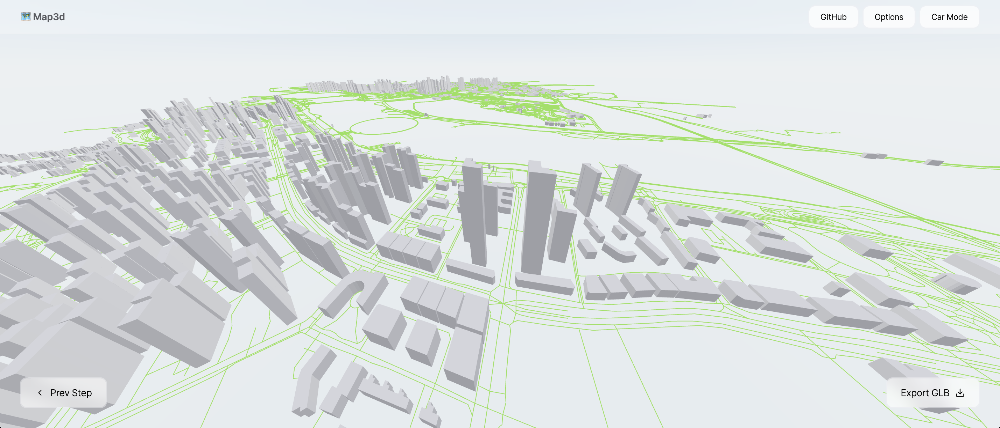
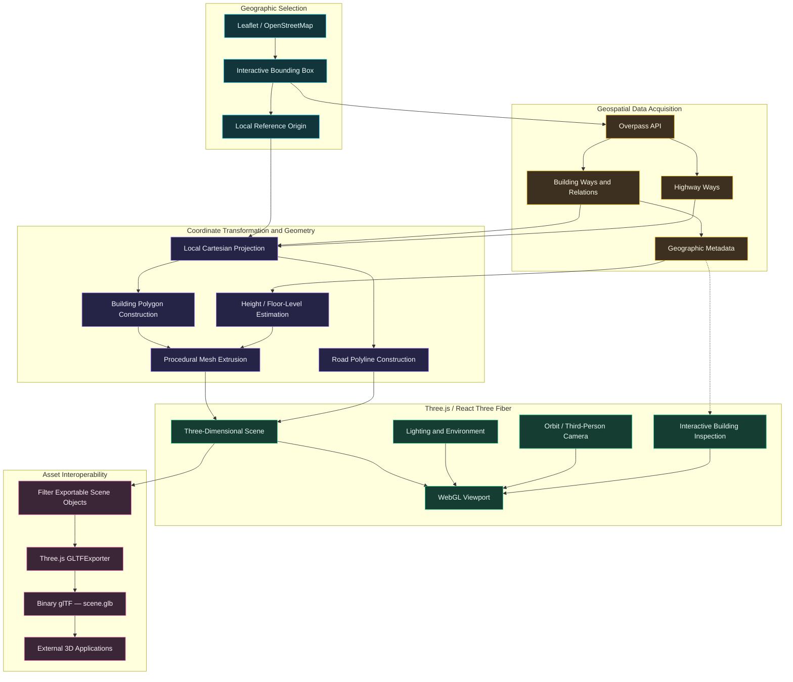

<div align="center">

  <h1>3D Map Render</h1>

  <p>
    <strong>From geographic coordinates to explorable worlds.</strong>
  </p>

  <p>
    An interactive geospatial visualization application exploring
    procedural urban reconstruction, geographic coordinate transformation,
    and real-world 3D environments through Three.js and OpenStreetMap.
  </p>

  [](https://react.dev/)
  [](https://www.typescriptlang.org/)
  [](https://threejs.org/)
  [](https://www.openstreetmap.org/)
  [](#scene-export)
  [](./LICENSE)

  <p>
    <a href="#overview">Overview</a> ·
    <a href="#visualization">Visualization</a> ·
    <a href="#geospatial-processing">Geospatial Processing</a> ·
    <a href="#rendering-pipeline">Pipeline</a> ·
    <a href="#scene-export">Export</a> ·
    <a href="#getting-started">Getting Started</a>
  </p>

  

  <br />

  <sub>
    Geographic information systems · Procedural geometry · Interactive 3D graphics
  </sub>

</div>

## Overview

3D Map Render is a browser-based geospatial graphics application
that transforms real-world geographic information into interactive
three-dimensional urban environments.

The application allows users to select a geographic region,
retrieve building footprints and road geometries from OpenStreetMap,
and reconstruct the selected area as a navigable 3D scene.

Geographic coordinates are transformed into a local Cartesian
coordinate system, while building footprints are converted into
volumetric meshes through procedural extrusion.

The resulting geometry can be explored directly within the
browser or exported as a binary glTF model for further
processing in external 3D applications.

The project brings together several areas of computer science,
geospatial computing, and computer graphics:

- Geographic Information Systems (GIS).
- Geographic coordinate transformation.
- Computational geometry.
- Procedural urban reconstruction.
- Interactive WebGL rendering.
- Spatial data visualization.
- Three-dimensional asset generation and interoperability.

## Visualization

The application provides a complete workflow from geographic
area selection to interactive three-dimensional exploration.

https://github.com/user-attachments/assets/1b61c2f8-dcf9-40bb-9804-59f6a74594dc

<p align="center">
  <sub>
    Original implementation demonstration — geographic selection,
    procedural building generation, road visualization, and interactive
    exploration of the reconstructed environment.
  </sub>
</p>

The reconstructed environment represents building geometry
through simplified volumetric meshes, while road networks
are displayed as contrasting linear structures.

This visual approach emphasizes urban morphology, spatial
relationships, building distribution, and transportation
network topology rather than photorealistic reconstruction.

## Features

| Feature | Description |
| :--- | :--- |
| **Interactive Geographic Selection** | Define a geographic region using a rectangular selection on a navigable map. |
| **OpenStreetMap Integration** | Access real-world geographic information and map tiles. |
| **Overpass API Queries** | Retrieve building footprints, road geometries, and associated metadata. |
| **Coordinate Transformation** | Convert latitude and longitude into local Cartesian coordinates. |
| **Procedural Buildings** | Generate three-dimensional building meshes from geographic polygons. |
| **Height Estimation** | Derive building extrusion depth from available height and floor-level metadata. |
| **Road Visualization** | Reconstruct road networks as three-dimensional polylines. |
| **Building Inspection** | Explore geographic tags and building metadata through interactive overlays. |
| **Orbit Navigation** | Navigate the reconstructed scene using orbital camera controls. |
| **Third-Person Exploration** | Explore urban environments through a controllable vehicle representation. |
| **GLB Export** | Export selected scene geometry into a portable binary glTF file. |
| **Reactive State Management** | Coordinate geographic selection, navigation modes, and export actions through Zustand. |
| **Browser-Based Rendering** | Interactive visualization powered by Three.js and React Three Fiber. |

## Geospatial Processing

The reconstruction process begins with geographic data
represented through latitude and longitude coordinates.

Building footprints and road geometries are retrieved
from OpenStreetMap through spatially constrained
Overpass API queries.

### Geographic Bounding Box

A selected region is represented by its geographic
bounding coordinates:

$$
B=(\phi_S,\lambda_W,\phi_N,\lambda_E)
$$

Where:

| Symbol | Description |
| :---: | :--- |
| $\phi_S$ | Southern latitude boundary. |
| $\lambda_W$ | Western longitude boundary. |
| $\phi_N$ | Northern latitude boundary. |
| $\lambda_E$ | Eastern longitude boundary. |

The application uses Leaflet to provide interactive
map navigation and rectangular area selection.

Both mouse-based and touch-based region selection
are implemented.

The selected bounding box determines the spatial
extent of the geographic queries.

### Geographic Data Acquisition

The application retrieves two principal categories
of geographic information.

| Geographic Feature | OpenStreetMap Tag | Representation |
| :--- | :--- | :--- |
| Buildings | `building` | Geographic polygon footprints and metadata. |
| Roads | `highway` | Geographic sequences describing road geometry. |

Building data is requested using Overpass queries
that include both ways and relations.

Road data is retrieved through a separate query
targeting highway ways.

An illustrative building query is:

```text
[out:json][timeout:25];
(
  way["building"](south,west,north,east);
  relation["building"](south,west,north,east);
);
out body geom;
```

The bounding-box placeholders are replaced with
the selected geographic coordinates at runtime.

The response contains feature identifiers, geographic
geometry, and available OpenStreetMap tags.

### Local Coordinate Transformation

Geographic coordinates cannot be used directly as
Cartesian coordinates within a conventional 3D scene.

The application therefore defines a local reference
point at the center of the selected geographic region.

$$
\phi_0=\frac{\phi_N+\phi_S}{2}
$$

$$
\lambda_0=\frac{\lambda_E+\lambda_W}{2}
$$

Each geographic point is subsequently transformed
using a local planar approximation:

$$
x=
S(\lambda-\lambda_0)
\cos\left(\frac{\pi\phi_0}{180}\right)
$$

$$
y=
S(\phi-\phi_0)
$$

Where:

- $\phi$ represents latitude in degrees.
- $\lambda$ represents longitude in degrees.
- $\phi_0$ and $\lambda_0$ define the local origin.
- $S=51000$ represents the configured scene scale.

The cosine correction accounts approximately for
the convergence of longitude lines toward the poles.

The resulting coordinates are mapped onto the
horizontal plane of the Three.js scene:

$$
(X,Y,Z)=(x,h,-y)
$$

Here, $h$ represents the vertical scene coordinate.

This transformation is implemented in
[`Space.tsx`](./src/three/Space.tsx).

The method is a simplified local projection suitable
for visual experimentation. It does not establish
a standardized coordinate reference system or
survey-grade metric accuracy.

## Rendering Pipeline

The application connects geographic data acquisition,
coordinate transformation, procedural geometry,
interactive rendering, and asset export.



The geographic processing and geometry generation
are performed within the client application.

React manages the user interface and application
lifecycle, while React Three Fiber connects the
declarative component architecture to Three.js.

The rendering layer transforms the generated spatial
geometry into an interactive WebGL environment.

## Interactive Exploration

The application provides multiple ways to inspect
and explore the reconstructed environment.

### Geographic Selection

The initial interface provides a conventional
two-dimensional map powered by Leaflet.

Users can navigate the map, adjust its zoom level,
switch into selection mode, and define a rectangular
region for reconstruction.

| Control | Responsibility |
| :--- | :--- |
| **Select Box** | Enable geographic region selection. |
| **Back to Drag** | Restore normal map navigation. |
| **Remove Box** | Clear the current geographic selection. |
| **Next Step** | Advance to geographic data retrieval and reconstruction. |
| **Prev Step** | Return to the previous application stage. |

The application displays a confirmation dialog
when the selected geographic extent exceeds
its configured size threshold.

### Building Inspection

Rendered building meshes respond to pointer
interaction and selection events.

Hovering or selecting a building highlights
its geometry and displays an informational
overlay containing available OpenStreetMap tags.

| Metadata | Description |
| :--- | :--- |
| Name | Geographic feature or building name. |
| Building Type | Classification of the building. |
| Height | Recorded height information. |
| Levels | Number of building floors. |
| Amenity | Associated facility or public service. |
| Address | Available street and address information. |
| Additional Tags | Other metadata associated with the geographic feature. |

The available information depends on the
completeness of the original OpenStreetMap data.

### Camera Navigation

The application supports two navigation modes.

| Mode | Description |
| :--- | :--- |
| **Orbit Mode** | Rotate, zoom, and pan around the reconstructed urban scene. |
| **Car Mode** | Explore the environment using a controllable object and a third-person follow camera. |

Car Mode uses a simplified vehicle representation
with configurable movement logic implemented in
[`Car.tsx`](./src/three/Car.tsx).

The camera follows the object through interpolated
position updates.

### Third-Person Controls

| Input | Action |
| :--- | :--- |
| `W` | Accelerate forward. |
| `S` | Move backward. |
| `A` | Rotate left. |
| `D` | Rotate right. |
| Mouse Movement | Adjust orientation while pointer lock is active. |
| Mouse Click | Request pointer lock in Car Mode. |
| `Esc` | Exit Car Mode. |

The current vehicle implementation is intended for
visual exploration.

It does not implement road-following algorithms,
vehicle physics, traffic simulation, or collision
detection against building geometry.

## Technology Stack

<div align="center">

  

</div>

| Technology | Responsibility |
| :--- | :--- |
| **React 19** | Declarative application interface and component lifecycle. |
| **TypeScript 5.7** | Application logic and typed component architecture. |
| **Three.js r173** | Geometry generation, scene representation, and WebGL rendering. |
| **React Three Fiber 9** | React integration with the Three.js rendering architecture. |
| **React Three Drei 10** | Camera controls, environmental rendering, lines, and HTML overlays. |
| **Leaflet 1.9** | Interactive two-dimensional geographic mapping. |
| **React Leaflet 5** | React integration with Leaflet maps and geographic interaction. |
| **OpenStreetMap** | Geographic information and cartographic data. |
| **Overpass API** | Spatially constrained geographic data retrieval. |
| **Zustand 5** | Shared application state management. |
| **Emotion** | Component-based styling and responsive interfaces. |
| **Axios** | HTTP client for auxiliary service integration. |
| **Vite 6** | Development environment and production bundling. |
| **glTF / GLB** | Portable three-dimensional asset representation. |

## Getting Started

### Requirements

- Node.js 22 or another version compatible with Vite 6.
- npm.
- A modern browser with WebGL support.
- Internet access for geographic data retrieval.
- Git.

### Clone the Repository

```bash
git clone https://github.com/4beru/3d-map-render-demo.git

cd 3d-map-render-demo
```

### Install Dependencies

The repository includes a package lockfile.

Install the locked dependencies:

```bash
npm ci
```

### Start the Development Server

```bash
npm run dev
```

Open the local address displayed by Vite,
typically:

```text
http://localhost:5173
```

### Generate a Three-Dimensional Map

1. Navigate to the desired geographic location.
2. Enable rectangular selection using **Select Box**.
3. Draw a bounding box around the desired region.
4. Advance to the processing stage.
5. Request the available building information.
6. Continue to the reconstructed three-dimensional scene.
7. Explore the environment or inspect individual buildings.
8. Export the generated geometry using **Export GLB**.

Start with a small geographic region to limit
network requests, geometry generation time,
and browser memory consumption.

### Production Build

Generate the production application:

```bash
npm run build
```

The build script performs TypeScript compilation
and creates a production bundle using Vite.

Preview the generated application:

```bash
npm run preview
```

The production output is generated in:

```text
dist/
```

The application can be deployed to a static
web hosting platform.

External geographic services remain necessary
for the map reconstruction workflow.

### Available Scripts

| Command | Description |
| :--- | :--- |
| `npm ci` | Install dependencies using the lockfile. |
| `npm run dev` | Start the Vite development server. |
| `npm run build` | Generate the production application. |
| `npm run preview` | Preview the production build locally. |
| `npm run lint` | Invoke the configured ESLint command. |

The repository declares a lint command, although
an explicit ESLint configuration is not currently
included in the source tree.

---

<div align="center">

  <h3>The world, reconstructed one coordinate at a time.</h3>

  <p>
    Part of <strong>Geospatial Graphics</strong> — a collection
    of projects exploring geographic information, computational
    geometry, spatial visualization, and the digital reconstruction
    of real-world environments.
  </p>

  <p>
    <sub>Curated by Abel Ortega.</sub>
  </p>

  <a href="https://github.com/4beru">GitHub</a> ·
  <a href="https://www.aberu.site">Portfolio</a>

</div>
